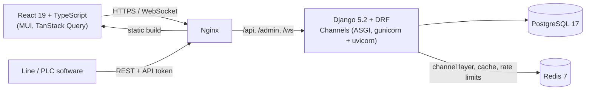

# Portfolio OEE & CMMS

[](https://github.com/djebabToufik/sample_project/actions/workflows/ci.yml)

A web platform for production plants that combines **OEE tracking** (Overall Equipment Effectiveness)
with a **CMMS** (Computerized Maintenance Management System). Lines report their state changes; the
platform turns them into live OEE, downtime and energy dashboards, and maintenance teams plan and
track their work on the same assets.


## Features

- **Live line view** over WebSockets: state, OEE of the last 24 h and production per line, updated as
  events arrive.
- **OEE dashboards**: availability, performance and quality for any period, with downtime counted per
  fault and per cell, and energy / cost estimates from the line's rates.
- **CMMS**: assets, maintenance plans with instructions (PDF), a maintenance agenda, and an operator
  view where technicians see and update their assigned work.
- **Multi-tenant**: every query is limited to the user's organization; roles (admin, operator) are
  enforced in the API, not only in the UI.
- **Accounts**: session login with HttpOnly cookie and CSRF, email invitation links instead of
  temporary passwords, password reset, rate limits on public endpoints.
- **Machine API**: other software sends line states (`POST /api/line-states/`) with an admin-issued API
  token; the server fills in the states a line skipped so durations stay consistent.
- **White-label ready**: names, logo and theme live in one place (`frontend/src/branding/`).

| OEE | Maintenance |
|---|---|
|  |  |
|  |  |

## Architecture



- **Event-sourced OEE.** A line's history is a list of state events (`on`, `run`, `fault`, `stop`, ...).
  OEE for any period is computed from the events in it plus the states already open at its start, so
  there is no pre-aggregated data to keep in sync. Durations are computed in UTC, so periods across a
  daylight-saving change are exact.
- **Live updates.** A new event notifies the line's Channels group; each connected consumer reloads
  its own view of the data and pushes it, so clients only ever receive data scoped to their
  organization.
- **Protected files.** Uploaded photos and PDFs are never served directly: Django checks access, then
  hands the file to nginx with `X-Accel-Redirect`.
- **Frontend.** Each area of the app is loaded on demand; React, the router and MUI sit in a separate
  bundle that browsers keep across releases. Server data goes through TanStack Query hooks in
  `src/data/`, and the session logic is isolated in `src/auth/`.

```
backend/
  backend/   settings, ASGI/WSGI entry points
  core/      organization scoping, permissions, auth, shared test helpers
  db/        organizations, users, assets, maintenance plans
  state/     events, OEE calculation (util.py), WebSocket consumers, line-state API
  apiv1/     CMMS API (assets, maintenance plans, users, protected files)
  users/     login, sign-up, invitations, password reset
frontend/
  src/AppMain/    pages per area (dashboards, CMMS, admin, operator view)
  src/components/ shared table, forms, dashboard cards and charts
  src/data/       API types, query hooks, live sockets, OEE formulas
  src/auth/       session handling
  src/branding/   name, logo and theme
  e2e/            Playwright tests
```

## Tech stack

| Area | Tools |
|---|---|
| Backend | Python 3.13, Django 5.2, Django REST Framework, Channels, PostgreSQL 17, Redis 7, uv, ruff |
| Frontend | React 19, TypeScript, MUI 9 (+ X Charts), TanStack Query 5, React Router 7, FullCalendar, Vite |
| Testing | Django test runner (136 tests), Playwright browser tests (80+) with a faked backend |
| Delivery | Docker (multi-stage, non-root backend image), docker compose, nginx, GitHub Actions |

## Run it locally

Requirements: Docker with docker compose.

```bash
cp .env.example .env        # then change the values marked change-me
docker compose up --build
```

Open <http://localhost> and log in with `OEE_SUPERUSER_USERNAME` / `OEE_SUPERUSER_PASSWORD` from `.env`.
With `DEMO=true` (the default in `.env.example`) that account owns a demo plant with lines, events
and maintenance plans. The Django admin is at <http://localhost/admin>.

On every start the backend applies migrations, checks the database schema against the models and
collects static files; no manual step is needed.

## Development

**Frontend** (from `frontend/`, Node 22):

```bash
npm install
npm run dev          # http://localhost:3000, proxies /api, /ws and /admin to the compose stack
npm run lint         # ESLint
npm run typecheck    # TypeScript
npm test             # Playwright tests (first time: npx playwright install chromium)
```

**Backend** (from `backend/`, with [uv](https://docs.astral.sh/uv/)):

```bash
uv sync                          # virtualenv with ruff
uv run ruff check . && uv run ruff format --check .
uv run python manage.py test     # needs PostgreSQL and Redis, see .github/workflows/ci.yml
```

Dependencies are pinned in `backend/uv.lock` and `frontend/package-lock.json`; the Docker images
install exactly those versions. CI runs lint, formatting, a migration check, all backend and browser
tests, and builds the Docker images on every push.

## License

GPL-3.0, see [LICENSE](LICENSE).
