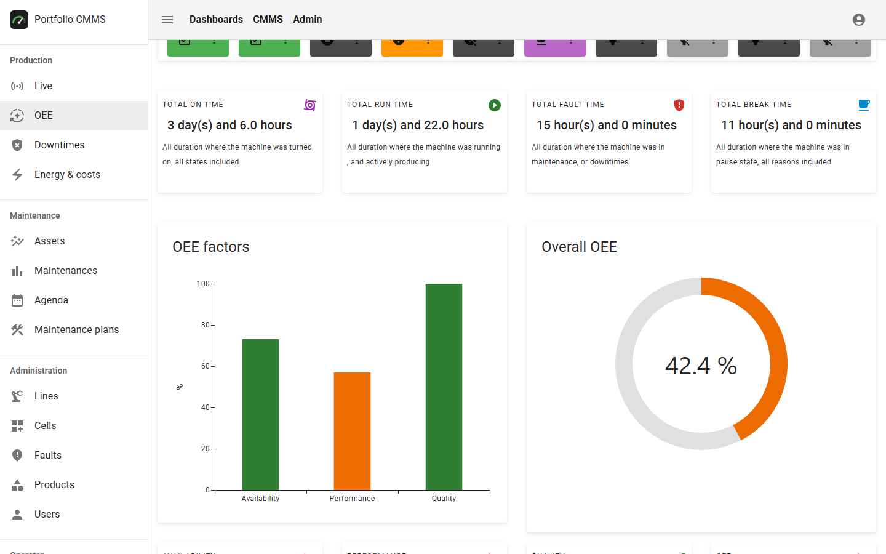
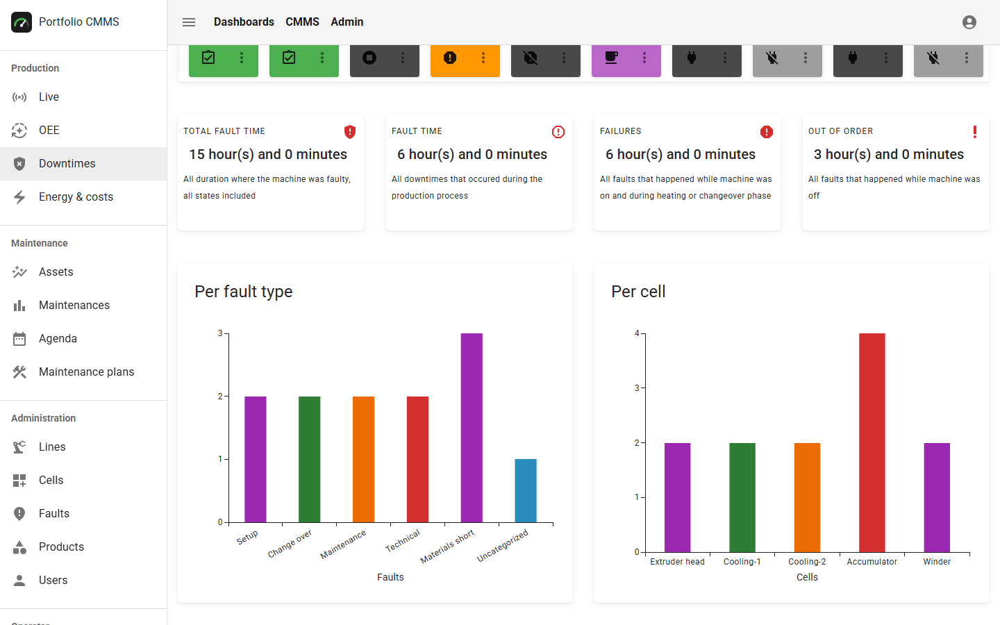
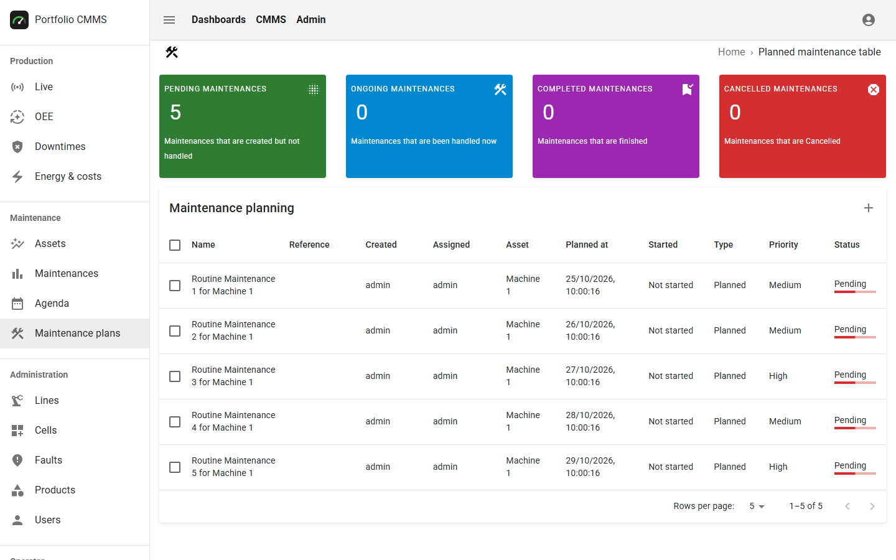
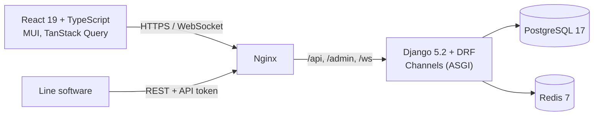
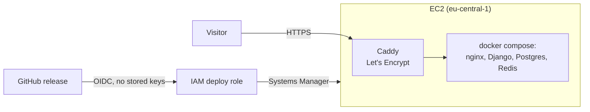

# Portfolio OEE & CMMS

[](https://github.com/djebabToufik/sample_project/actions/workflows/ci.yml)
[](https://codecov.io/gh/djebabToufik/sample_project)
[](https://github.com/djebabToufik/sample_project/releases)
[](LICENSE)

Production lines report their state changes; the platform turns them into live **OEE**
(Overall Equipment Effectiveness), downtime and energy dashboards, and maintenance teams plan
their work on the same assets (**CMMS**).

**Live demo: <https://demo.opensourceoeesoftware.com>**, log in with `demo` / `oee-demo`
(the data is reset every night).



## Run it

Requires Docker. Uses the published images, nothing is built locally:

```bash
cp .env.example .env
OEE_IMAGE_TAG=latest docker compose up --no-build
```

Open <http://localhost> and log in with `OEE_SUPERUSER_USERNAME` / `OEE_SUPERUSER_PASSWORD`
from `.env`. A demo plant with events and maintenance plans is created on first start.

## Highlights

- **Event-sourced OEE.** A line's history is a list of state events; OEE for any period is computed
  from them, so there are no aggregates to keep in sync.
- **Live updates** over WebSockets (Django Channels + Redis), scoped to the user's organization.
- **Multi-tenant by design.** Every query is limited to the user's organization, and roles are
  enforced in the API, not only in the UI.
- **Secure defaults.** Session cookies with CSRF, invitation links instead of passwords, rate limits,
  uploaded files served only after an access check (`X-Accel-Redirect`).
- **Machine API.** Line software posts state changes with an API token.
- **Documented API.** OpenAPI schema generated from the code, browsable with Swagger UI at
  `/api/docs/` ([live](https://demo.opensourceoeesoftware.com/api/docs/)); CI fails if an endpoint is
  left undocumented.

| Downtimes | Maintenance plans |
|---|---|
|  |  |

## Architecture



## Delivery

Every change goes through a pull request with a [Conventional Commit](https://www.conventionalcommits.org)
title. Each image is **built once** and the same digest is promoted to release:

1. **Pull request:** lint and test what changed, build the images whose folder changed, scan them
   (Trivy), start the stack from them and run a smoke test, push to GHCR as `tree-<hash>`.
2. **Merge:** no rebuild. The tested images are retagged `sha-<commit>` and `main`.
3. **Release:** [release-please](https://github.com/googleapis/release-please) writes the changelog
   and version; the same images are tagged `x.y.z` and `latest`.
4. **Deploy:** the release goes to the [live demo](https://demo.opensourceoeesoftware.com), then a
   smoke test logs in to it over HTTPS.

Nightly, the full test suite runs and the current images are scanned again. Dependabot proposes
dependency updates weekly and CodeQL analyzes the code (see [SECURITY.md](SECURITY.md)). Details in
[`.github/workflows`](.github/workflows).

## Infrastructure

The live demo runs on AWS, described in Terraform ([`infra/`](infra)):



- **One server, the same compose stack as locally**, with Caddy in front for HTTPS. Only ports
  80 and 443 are open: there is no SSH, commands reach the server through AWS Systems Manager.
- **Deploys without AWS keys.** GitHub's OIDC token gets short-lived credentials for a role that
  only trusts this repository's `demo` environment and can only run commands on the demo server.
  The server then pulls the release's images: the ones tested in CI.
- **Secrets stay on the server.** They are generated on first boot and are not in Git, in
  Terraform or in GitHub.
- **Cheap to run and to throw away.** About 20 USD a month with a budget alert, the demo data is
  reset every night, and `terraform destroy` removes everything.

## Design decisions

**Build once, promote the same image.**
Rebuilding at merge or release would produce an image nobody tested: base images and system
packages change between builds even when the code does not. Here a released image is byte-for-byte
the one that passed the tests, the scan and the smoke test, provable by its digest.
Merges and releases take seconds instead of a full build, a rollback is just pointing to an older
tag, and pull requests that don't touch a service reuse its image.
*Trade-off:* branches must be up to date before merging (otherwise `main` could differ from what
was tested), and the workflows carry more logic than "build on every push".

**OEE computed from raw events.**
Lines only store state changes; OEE, downtime and energy are computed from them for any period on
request. There are no stored totals that could drift from the events, and a new report only needs a
new calculation, not a data migration.
*Trade-off:* long periods cost more to compute; at a larger scale they would need a cache or
periodic snapshots.

**Multi-tenancy in one database.**
Every row belongs to an organization, and one shared view mixin (`OrganizationScopedMixin`) limits
every API query to the user's organization; live WebSockets check the line the same way. One
database is simple to run and to back up.
*Trade-off:* a view that skipped the mixin would leak data, so the tests keep a second
organization and check that its data stays out of reach.

**Session cookies instead of JWT.**
The browser keeps an HttpOnly session cookie that scripts cannot read, and logging out ends the
session on the server at once. Machines use API tokens instead.
*Trade-off:* every change needs a CSRF token, and the app must know its public origin
(`OEE_CSRF_TRUSTED_ORIGINS`) when it runs behind another host or port.

## Development

```bash
# backend/ (needs Postgres and Redis, see ci.yml)
uv sync && uv run python manage.py test

# frontend/
npm ci
npm run dev     # http://localhost:3000, proxies the API to the compose stack
npm test        # Playwright tests
```

## License

GPL-3.0, see [LICENSE](LICENSE).
