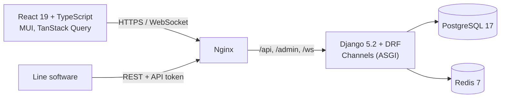

# Portfolio OEE & CMMS

[](https://github.com/djebabToufik/sample_project/actions/workflows/ci.yml)
[](https://github.com/djebabToufik/sample_project/releases)
[](LICENSE)

Production lines report their state changes; the platform turns them into live **OEE**
(Overall Equipment Effectiveness), downtime and energy dashboards, and maintenance teams plan
their work on the same assets (**CMMS**).


## Run it

Requires Docker. Uses the published images, nothing is built locally:

```bash
cp .env.example .env
OEE_IMAGE_TAG=latest docker compose up --no-build
```

Open <http://localhost> and log in with `OEE_SUPERUSER_USERNAME` / `OEE_SUPERUSER_PASSWORD`
from `.env`. A demo plant with events and maintenance plans is created on first start.

## Highlights

- **Event-sourced OEE.** A line's history is a list of state events; OEE for any period is computed
  from them, so there are no aggregates to keep in sync.
- **Live updates** over WebSockets (Django Channels + Redis), scoped to the user's organization.
- **Multi-tenant by design.** Every query is limited to the user's organization, and roles are
  enforced in the API, not only in the UI.
- **Secure defaults.** Session cookies with CSRF, invitation links instead of passwords, rate limits,
  uploaded files served only after an access check (`X-Accel-Redirect`).
- **Machine API.** Line software posts state changes with an API token.

| Downtimes | Maintenance plans |
|---|---|
|  |  |

## Architecture



## Delivery

Every change goes through a pull request with a [Conventional Commit](https://www.conventionalcommits.org)
title. Each image is **built once** and the same digest is promoted to release:

1. **Pull request:** lint and test what changed, build the images whose folder changed, scan them
   (Trivy), start the stack from them and run a smoke test, push to GHCR as `tree-<hash>`.
2. **Merge:** no rebuild. The tested images are retagged `sha-<commit>` and `main`.
3. **Release:** [release-please](https://github.com/googleapis/release-please) writes the changelog
   and version; the same images are tagged `x.y.z` and `latest`.

Nightly, the full test suite runs and the current images are scanned again. Details in
[`.github/workflows`](.github/workflows).

## Development

```bash
# backend/ (needs Postgres and Redis, see ci.yml)
uv sync && uv run python manage.py test

# frontend/
npm ci
npm run dev     # http://localhost:3000, proxies the API to the compose stack
npm test        # Playwright tests
```

## License

GPL-3.0, see [LICENSE](LICENSE).
